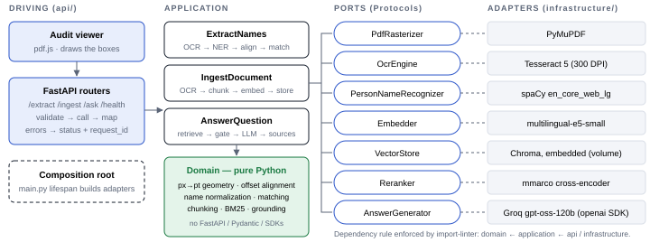
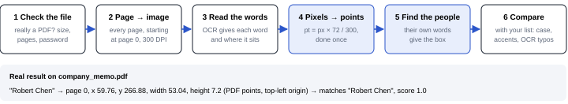
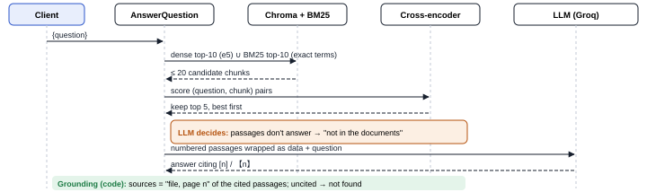
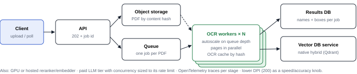

# DESIGN — Document Intelligence Service

> **3-page PDF version: [DESIGN.pdf](DESIGN.pdf)** — same content.

Give it a scanned PDF and it returns every person mentioned, with the page and the exact
box where the name sits, so a reviewer can check it. It also compares those names with a
list you send, and answers questions about uploaded documents, citing the page each
answer comes from.

| Names found that are real people / real people found | Boxes verified | Questions answered correctly (3 runs each) | Made-up sources |
|---|---|---|---|
| 100 % / 98 % | 54 of 54 | 15 of 15 | 0 |

## 1. How the pieces fit together

Each engine sits behind its own small interface: it can be swapped through
configuration, or replaced by a fake in tests.

## 2. Finding names and where they are

- **Boxes are in PDF points, not image pixels** (72 per inch, origin at the top-left), so
  they line up with the PDF whatever resolution was used to read it.
- **The box comes from the person's own words.** The name finder marks a person in the
  page text; we take exactly the OCR words it covers and draw the box around them. A name
  that appears five times gets five boxes, and titles like "Dr." stay outside.
- **Matching compares whole names**, ignoring case, accents and punctuation:
  *María González* matches *Maria Gonzalez*, but *Ana* does not match
  *Ana María Rodríguez*.

## 3. Answering a question

- **Indexing.** Each uploaded document is read the same way, then split into chunks of
  whole paragraphs (never cutting a word, never crossing a page). Chunk ids start with a
  fingerprint of the file, so a second document can't overwrite the first and uploading
  the same file twice doesn't duplicate it.
- **Two searches, then a ranking.** A search by meaning finds paraphrases; a search by
  exact words finds names and figures the first one misses. A re-ranker then reads each
  candidate next to the question and keeps the best five.
- **The LLM decides if the answer is there.** It answers only from those five passages,
  or says it isn't in the documents. We first tried a score cut-off to decide that, and
  dropped it: it rejected easy questions like "Who is the CEO?".
- **Sources can't be invented.** The LLM only cites passage numbers; the service turns
  them into "file, page n" from the passages it actually sent.

## 4. Technology choices and trade-offs

| Need | Choice | Why | Trade-off |
|---|---|---|---|
| Read scanned text | Tesseract | Free, runs on CPU, gives each word's position | Struggles with poor scans; a cloud OCR could replace it |
| PDF → images | PyMuPDF | Fast, knows page sizes in points | AGPL licence; pypdfium2 if that matters |
| Find people | spaCy (large English model) | Measured best on our samples; the small model mistook a project and a magazine for people | ~400 MB more; weak on ALL-CAPS text |
| Compare names | rapidfuzz | Whole-name similarity, fast | A fixed threshold (0.90): configurable |
| Search by meaning | e5 (multilingual) + Chroma | Spanish and English, no extra servers | One process writes; a database service at scale |
| Rank results | Multilingual cross-encoder | ~1.5 s per question on CPU | A stronger model took 21 s on CPU |
| Write answers | Groq, gpt-oss-120b | Free and fast; any OpenAI-compatible provider by config | Rate limits on the free tier; text leaves the machine |

## 5. Scaling to 1000+ PDFs an hour

1000 PDFs an hour is one every 3.6 seconds. Reading a page takes 2–3 seconds of CPU, so
with 5 pages per PDF that is about 4 busy cores (8 with headroom). The heavy work moves
out of the request: the upload returns a job id right away, and workers that scale with
the queue do the reading.

## 6. What can go wrong and what happens

| Failure | What we do | Caller sees |
|---|---|---|
| Not a PDF, empty, too big, too many pages, password | Checked before any work starts | 4xx with a specific code |
| OCR engine missing or stuck | Time limit per page | 503 |
| Poor scan | Words the OCR is unsure of are dropped, so no box is drawn over noise | fewer names |
| LLM slow, busy or down | Time limit and automatic retries; names and indexing keep working | 503 / 502 |
| Answer not in the documents | The LLM says so; an answer that cites nothing counts as "not found" | "not found" |
| A document tries to give the LLM orders | Document text is marked as data; the LLM has no tools | normal answer |
| Same file uploaded twice | Same fingerprint, so it replaces itself | no duplicates |
| Text in ALL CAPS | Known limit of the name finder | documented |

## 7. Choosing a model by question difficulty

Simple lookups ("Who is the CEO?") go to a small, cheap model; questions that compare, add
up or ask "why" across several passages go to the large one. The choice is made by plain
rules after the search (how many passages look relevant, words like "compare" or "why"),
not by another LLM. If the small model gives an answer without citations while the search
found good evidence, the question is retried once on the large model. The rules are tuned
on our test questions, for accuracy and cost.

Details: [DECISIONS.md](DECISIONS.md) (decisions, limitations, use of AI).
