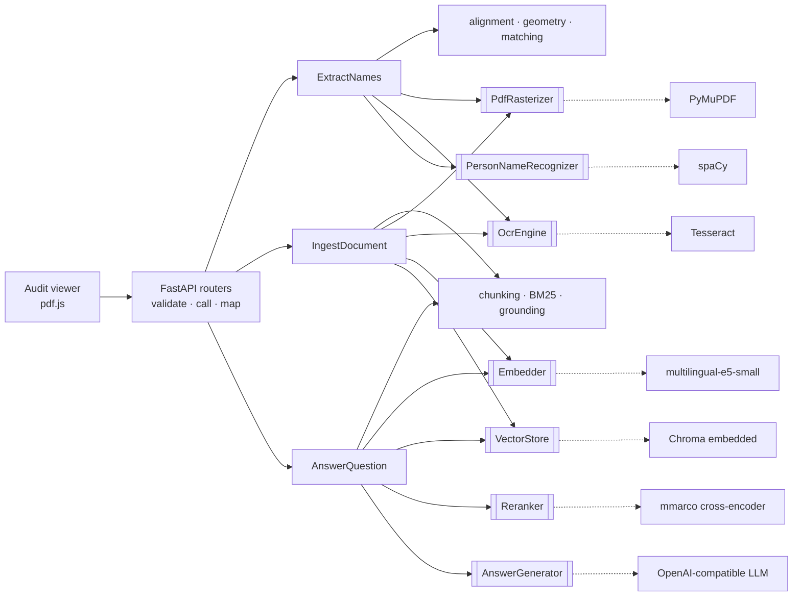
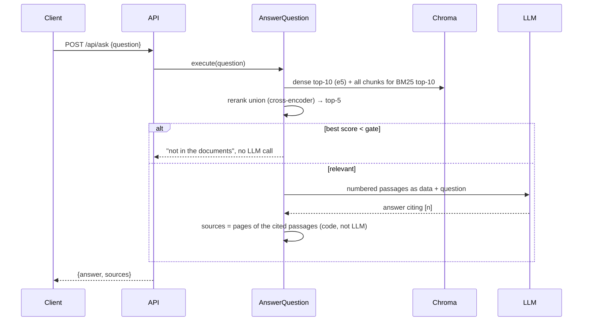

# DESIGN — Document Intelligence Service

A FastAPI service that OCRs scanned PDFs, returns every **person name with its page and
box in PDF points**, fuzzy-matches those names against a requested list, and answers
questions over ingested documents with grounded RAG. The full technical record is the
[TRD](docs/trds/document-intelligence-trd.md) and its ADRs; this page is the summary.

## 1. Components

Hexagonal architecture: the domain is pure Python, use cases depend only on **ports**
(`Protocol`s), and every library sits in one adapter. `app/main.py` is the only place
adapters are built; `import-linter` fails the build if a layer imports the wrong way.

`domain/` (pure) ← `application/` (use cases + ports) ← `infrastructure/` (adapters) and
`api/` (HTTP). Domain and application never import FastAPI, Pydantic or a vendor SDK.

## 2. Flows

**Extract.** Validate the upload by content → render every page at 300 DPI → Tesseract
returns words with pixel boxes → converted **once** to PDF points (`pt = px × 72 / DPI`,
top-left origin) → page text is rebuilt from the words while recording each word's
character offsets → spaCy marks PERSON spans → each span maps back to exactly the words
it covers → their boxes merge into one box per occurrence (honorifics excluded) → names
are normalized (case, accents, punctuation) and compared to the requested list with
`max(ratio, token_sort_ratio) ≥ 0.90`.

**Ingest.** Same OCR → OCR layout blocks packed into ≤ 250-token, page-bounded chunks
that never cut a word → embedded → upserted with id `{sha256(pdf)}:{chunk}`, so a second
document can't overwrite the first and re-ingesting the same file changes nothing.

## 3. Technology choices and trade-offs

| Need | Choice | Why / trade-off |
|---|---|---|
| OCR | Tesseract 5 | Word boxes + confidence, light, CPU. Weaker on poor scans → swap the `OcrEngine` adapter (docTR, cloud OCR). |
| PDF → image | PyMuPDF | Page size in points, handles rotation. AGPL → pypdfium2 if sold commercially. |
| NER | spaCy `en_core_web_lg` | Only model that met P/R ≥ 0.90 with zero ORG leaks on the samples (P 1.00 / R 0.98); no torch. |
| Matching | rapidfuzz on normalized full names | Full-string similarity, no substring inflation; `thefuzz` is now a wrapper over it. |
| Embeddings | `multilingual-e5-small` | Spanish + English, 384-d, CPU. |
| Retrieval | dense ∪ BM25 → cross-encoder | Dense misses exact names/figures, BM25 catches them; the reranker's score also powers the "not found" gate. |
| Vector store | Chroma, embedded | Zero infrastructure (allowed by the brief); persisted on a Docker volume. |
| LLM | Groq `gpt-oss-120b` via the openai SDK | Any OpenAI-compatible endpoint by config; SDK gives timeouts and backoff retries. |

## 4. Scaling to 1000+ PDFs/hour

1000 PDFs/h is 0.28 PDF/s. OCR dominates at ~2–3 CPU-seconds per page, so a 5-page
average needs ~4 cores busy all the time — ~8 with headroom. The CPU work moves out of
the request:

1. **Async jobs.** `POST` stores the PDF in object storage, enqueues a job and returns
   `202` + job id; results are fetched or pushed by webhook.
2. **Stateless OCR workers** (this same image) consume the queue and autoscale on
   queue depth; pages of one PDF can run in parallel.
3. **OCR cache by content hash**: extract and ingest of the same file OCR it once.
4. **Vector store as a service** with native hybrid search (Qdrant/OpenSearch) behind
   the same `VectorStore` port; BM25-per-query stops scaling past ~10⁴ chunks.
5. **GPU or hosted reranker/embedder**; paid LLM tier with a concurrency limit sized to
   its rate limit.
6. **Tracing** (OpenTelemetry) per stage, on top of today's JSON logs with `request_id`.

## 5. Failure modes and mitigations

| Failure | Mitigation |
|---|---|
| Not a PDF, empty, too big, too many pages, encrypted | Checked by content before any OCR → 4xx with a specific `error.code`. |
| Tesseract missing or stuck | Per-page timeout → 503 `ocr_unavailable` with `request_id`. |
| Poor scan / low-confidence words | Words below a confidence floor are dropped, so no box lands on noise. |
| LLM slow, rate-limited or down | SDK timeout + exponential-backoff retries → 503/502 with a specific code; extract and ingest keep working. |
| LLM invents a source | Impossible: `sources` are built by code from the passages actually sent and cited; an uncited answer becomes "not found". |
| Question not covered by the documents | Rerank-score gate answers "not found" without calling the LLM. |
| Prompt injection inside a document | Passages are delimited and declared data; the LLM has no tools; the viewer renders answers as plain text. |
| Duplicate ingest | Content-hash ids make it an idempotent upsert. |

## 6. Routing between models by query complexity

`AnswerGenerator` is a port, so routing is one more adapter — no use case changes. A
deterministic router scores each question **after** retrieval: number of relevant
passages above the gate, cues for comparison, aggregation or "why", and question length.
Single-fact lookups go to a small fast model (`gpt-oss-20b`); multi-passage or reasoning
questions go to the large one. If the small model's answer has no valid citation while
the gate said evidence exists, the router retries once on the large model. Thresholds are
tuned on the golden Q&A set (pass^3 and cost per answer), never by the LLM itself.
