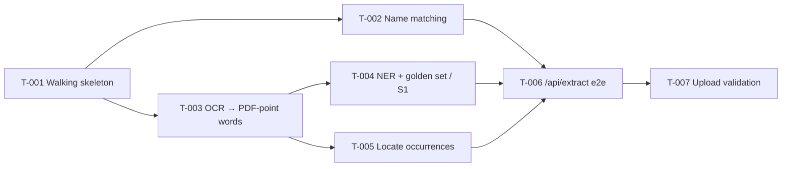

# Spec: Extraction — Ticket Breakdown

Foundation (TRD §14 P0) + name extraction (TRD §14 P1): a hexagonal FastAPI service whose
`POST /api/extract` OCRs every page of a scanned PDF, returns each person name with its
0-based page and bounding box in PDF points, and fuzzy-matches the names against a
requested list. RAG (P2), bonus (P3) and delivery (P4) are separate epics, specced later.

**Sources:** PRD = `README.md` · TRD = `docs/trds/document-intelligence-trd.md` (v0.1,
2026-10-21) · rules = `CONSTITUTION.md`, `CLAUDE.md`.

## PRD objectives (the README has no numbered objectives; ids assigned here)

| ID | Objective | README source | Measurable by |
|---|---|---|---|
| O1 | Return each person name with its 0-based page and bounding box in PDF points | §Why this exists; §2 steps 1–3; §Correctness details | TRD §1: 100 % pages OCR'd; NER P/R ≥ 0.90; 100 % boxes pass self-check; occurrence recall ≥ 0.95 |
| O2 | Fuzzy-match extracted names against the requested list (case/accent/OCR-noise robust, full-string) | §2 step 4; §Correctness details | TRD §1: 100 % of golden match pairs |
| O3 | Production judgment: architecture + DI, config, resilience, validation, resource management, observability | §Requirements that matter | `docs/requirements-traceability.md` checks |
| O4 | Tests covering the tricky logic + ≥ 1 end-to-end path | §Requirements → Tests | Test suites per CONSTITUTION §7 |
| O5 | Liveness probe | §1 `GET /health` | `GET /health` → 200 `{"status":"ok"}` |

## Ticket index

| ID | Title | Objectives | Depends on | Wave |
|---|---|---|---|---|
| T-001 | Walking skeleton: hexagonal service with health, config, logging and quality gate | O3, O5 | none | 1 |
| T-002 | Match extracted names against requested names | O2, O4 | T-001 | 2 |
| T-003 | OCR every page into words with boxes in PDF points | O1, O3, O4 | T-001 | 2 |
| T-004 | Recognize person names and measure NER against a golden set (spike S1) | O1, O4 | T-003 | 3 |
| T-005 | Locate every occurrence of a recognized name on its page | O1, O4 | T-003 | 3 |
| T-006 | `POST /api/extract` end to end | O1, O2, O3, O4 | T-002, T-004, T-005 | 4 |
| T-007 | Reject invalid uploads and malformed name lists on `/api/extract` | O3, O4 | T-006 | 5 |

## Dependency graph

## Suggested wave order

- **Wave 1:** T-001.
- **Wave 2:** T-002 ∥ T-003 (pure domain vs OCR adapter — no shared files beyond the skeleton).
- **Wave 3:** T-004 ∥ T-005 (T-005 uses scripted entity spans, not the real NER).
- **Wave 4:** T-006.
- **Wave 5:** T-007.

**Prerequisite before T-003:** Tesseract installed locally (`winget install --id
tesseract-ocr.tesseract`, verify with `tesseract --version`) or integration tests run in
a container — see `CLAUDE.md` § Gotchas.

## Decisions made to fill gaps

- Epic slug `extraction` (not derived from `README.md`, which would give the meaningless
  `readme`); RAG will be its own epic.
- PRD objective ids O1–O5 assigned above because the README does not number them.
- Upload validation (T-007) comes after the happy path so the endpoint exists to host it;
  T-006 still rejects unreadable input with a generic 4xx path until T-007 refines it.
