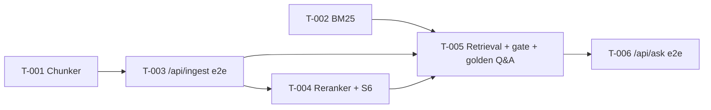

# Spec: RAG — Ticket Breakdown

RAG (TRD §14 P2): `POST /api/ingest` OCRs a scanned PDF, cuts it into word-safe chunks
and stores them in Chroma under IDs unique across documents; `POST /api/ask` answers any
question from those chunks — dense ∪ BM25 candidates, cross-encoder rerank, a relevance
gate, and an LLM (Groq) that cites numbered passages so `sources` are built by code.
Bonus (P3) and delivery (P4) are separate epics.

**Sources:** PRD = `README.md` · TRD = `docs/trds/document-intelligence-trd.md` (v0.1 +
2026-10-21 RAG revisions) · ADR-014, ADR-015 (`docs/adrs/`) · research
`reports/Chunking y retrieval para RAG.md` · rules = `CONSTITUTION.md`, `CLAUDE.md`.
**Builds on:** the extraction epic (`docs/specs/extraction/`) — OCR (`read_pages`),
upload validation (`read_pdf_upload`), settings, error mapping, logging.

## PRD objectives

O3 and O4 keep the ids of the extraction epic (`docs/specs/extraction/spec.md`); O6 and
O7 are new (the README does not number its objectives).

| ID | Objective | README source | Measurable by |
|---|---|---|---|
| O3 | Production judgment: DI, config, resilience (timeouts/retries on LLM), validation, resource management, observability | §Requirements that matter | `docs/requirements-traceability.md` checks |
| O4 | Tests covering the tricky logic + ≥ 1 end-to-end path | §Requirements → Tests | Test suites per CONSTITUTION §7 |
| O6 | Index a scanned PDF for RAG: OCR → chunk (never cutting words) → embed → store, IDs unique across documents | §3 `POST /api/ingest`; §Correctness details | Property test on the chunker; test "ingest A, ingest B, both retrievable" |
| O7 | Answer a question grounded in the retrieved chunks, with `sources` that are never hallucinated | §4 `POST /api/ask`; §Correctness details | TRD §1: retrieval hit@k 100 %; answer pass^3 ≥ 0.80; sources ⊆ retrieved chunks 100 % |

## Ticket index

| ID | Title | Objectives | Depends on | Wave |
|---|---|---|---|---|
| T-001 | Cut OCR pages into word-safe, token-bounded chunks | O6, O4 | none | 1 |
| T-002 | Rank chunks by exact terms (BM25) | O7, O4 | none | 1 |
| T-003 | `POST /api/ingest` end to end | O6, O3, O4 | T-001 | 2 |
| T-004 | Rerank (question, chunk) pairs with a cross-encoder (spike S6) | O7, O4 | T-003 | 3 |
| T-005 | Retrieve the most relevant chunks for any question, with a relevance gate | O7, O4 | T-002, T-003, T-004 | 4 |
| T-006 | `POST /api/ask` end to end with cited, code-built sources | O7, O3, O4 | T-005 | 5 |

## Dependency graph

## Suggested wave order

- **Wave 1:** T-001 ∥ T-002 (two pure domain functions, no shared files).
- **Wave 2:** T-003 (adds sentence-transformers + CPU torch + chromadb).
- **Wave 3:** T-004 (reuses T-003's sentence-transformers install — running it in parallel
  with T-003 would conflict on `pyproject.toml`/`uv.lock`).
- **Wave 4:** T-005.
- **Wave 5:** T-006.

**Prerequisite before T-006:** a Groq API key in `.env` (`DOCINTEL_LLM_API_KEY`); without
it the unit suite still passes (fakes) and the answer eval skips with a clear reason.

## Decisions made to fill gaps

- Epic slug `rag`; ticket ids restart at T-001 per epic (skill rule). Commit scopes use
  `rag/T-00N` so they never collide with the extraction epic's `T-00N`.
- **`sources` format:** one string per distinct cited (file, page): `"{file_name}, page
  {n}"`, `n` 0-based — the same page convention as `BoundingBox.page_number`.
- **No valid citation ⇒ "not found":** an LLM answer that cites no passage that was
  actually sent is not grounded, so `/ask` returns the deterministic not-found answer with
  `sources: []`. This also covers the LLM saying it doesn't know (that reply carries no
  citation), so no phrase detection is needed.
- **Citation markers stripped:** the `[n]` markers are removed from the returned `answer`;
  the reader follows `sources` instead (passage numbers mean nothing outside the prompt).
- **LLM error → HTTP status** (ADR-010's three errors): `LlmTimeout` → 503 `llm_timeout`,
  `LlmRateLimited` → 503 `llm_rate_limited`, `LlmUnavailable` → 502 `llm_unavailable`;
  missing key → 503 `llm_not_configured`.
- **Different documents never overwrite each other** (README §Correctness): every chunk id
  starts with the content hash of its PDF, so ingesting B leaves A's chunks untouched —
  T-003 criterion 1 proves it.
- **Only the *same* PDF (identical bytes) replaces itself:** re-ingesting it deletes that
  same document's chunks and stores them again, so it is never duplicated and a changed
  `CHUNK_MAX_TOKENS` never leaves stale chunks. `status` is `"ingested"` in both cases.
- **File name:** the upload's file name is stored as chunk metadata; when the client sends
  none, the document id is used in its place.
- **Vector store mode:** this epic ships the embedded `PersistentClient`. The HTTP mode
  (and its retries) arrives with the Docker epic, where the store becomes a separate
  service; embedded Chroma is in-process, so there is no network call to retry.
- **`/health` unchanged:** a missing LLM key is logged once at startup
  (`llm_not_configured`) and `/ask` answers 503; adding a field to `HealthResponse` is not
  worth a contract change. *Deviates from TRD §10 ("`/health` reports it") — confirm at the
  gate.*
- **Golden Q&A** (~12 items: answerable with expected file + page + fact, unanswerable, one
  prompt-injection probe) lives in T-005 and is reused by T-006's answer eval.
