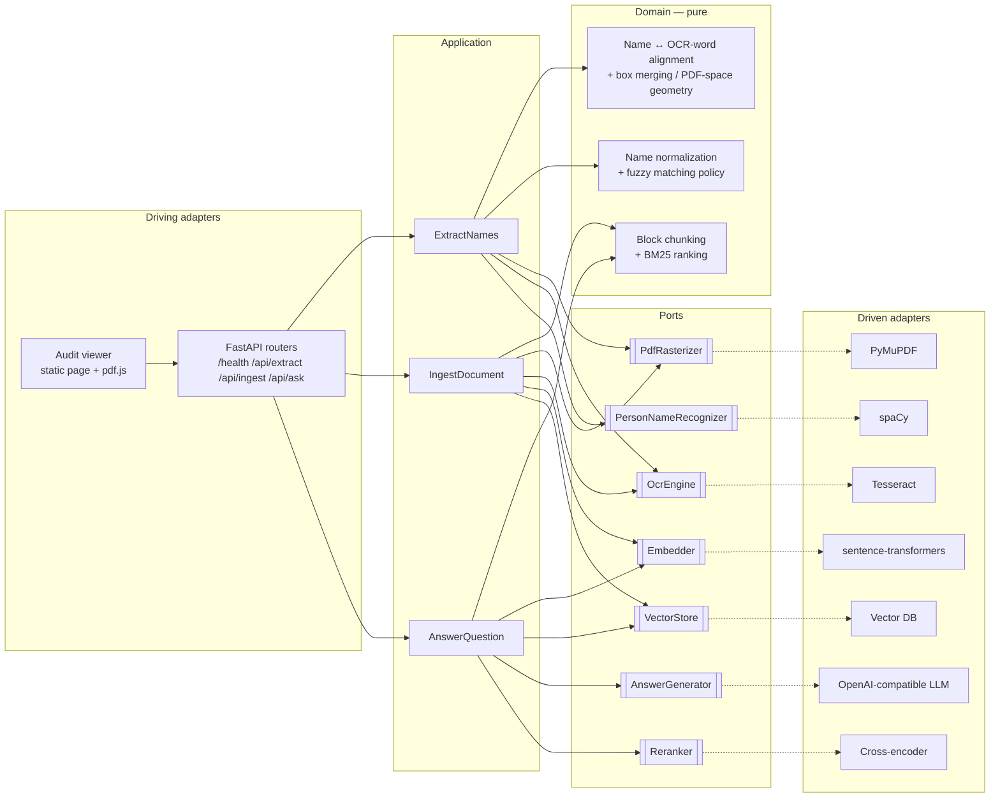

# TRD — Document Intelligence Service

## 0. Metadata

| | |
|---|---|
| Product | Document Intelligence Service (ML Engineer take-home) |
| Technical owner | Pablo Guatibonza (with AI assistance — disclosed in `DECISIONS.md`) |
| Date / version | 2026-10-21 · v0.1 |
| Status | Draft — pending owner review |
| PRD | [`README.md`](../../README.md) — the take-home brief acts as the PRD (problem, contract, acceptance criteria, evaluation weights). Cited below as **PRD §<heading>**. |
| Fixed contract | [`app/models/schemas.py`](../../app/models/schemas.py) |
| Engineering standard | [`CONSTITUTION.md`](../../CONSTITUTION.md) · agent rules [`CLAUDE.md`](../../CLAUDE.md) · [ADR-012](../adrs/ADR-012-fastapi-pydantic-layering.md) |
| Sample corpus | `sample_pdfs/` — 3 PDFs, 5 pages, US Letter (612×792 pt), scanned at 150 DPI (1275×1650 px), English, no text layer |

---

## 1. Technical summary, scope, and success criterion

**Approach.** A single FastAPI service built with **hexagonal architecture**: a pure
domain (name alignment, bounding-box geometry, name normalization/matching, chunking),
thin application use cases (`ExtractNames`, `IngestDocument`, `AnswerQuestion`) that
talk to the outside only through ports, and swappable infrastructure adapters
(Tesseract OCR, spaCy NER, sentence-transformers embeddings, vector store,
OpenAI-compatible LLM). Processing is a **deterministic workflow**; the LLM is used in
exactly one step — composing the RAG answer — because that is the only place where
reasoning over free text adds value. Everything a compliance reviewer must be able to
trust (names, pages, boxes, match scores, sources) is produced by deterministic code,
never by the LLM.

**Autonomy level.** Tool, not agent: every request is a bounded, synchronous pipeline
with no autonomous actions and no state-mutating side effects except vector-store
ingestion (made idempotent, §10).

**Success criterion (measurable).**

| Capability | Metric | Threshold |
|---|---|---|
| OCR coverage | pages processed / pages in PDF | **100 %** (every page, incl. page 0) |
| PERSON extraction | precision and recall vs. golden set (`sample_pdfs`) | **≥ 0.90** each; zero ORG/GPE/DATE leaks on the golden set |
| Box correctness | returned boxes that, re-OCR'd from their crop, fuzzy-match the name (≥ 0.90) | **100 %** of returned boxes; all coordinates inside the page rect in points |
| Occurrence completeness | occurrences located / occurrences in golden set | **≥ 0.95** |
| Fuzzy matching | golden pairs (accent, case, OCR-noise variants, negatives) | **100 %** — deterministic, regression-grade |
| RAG retrieval | expected source in top-k on golden Q&A | **100 %** |
| RAG answer | grounded answer contains expected fact, **pass^3** | **≥ 0.80** of questions pass all 3 runs |
| Grounding | `sources` ⊆ retrieved chunks | **100 %** (by construction) |

**Out of scope.** Authentication/authorization, multi-tenancy, persistent storage of
uploaded PDFs, async job queue (described as the scaling path in `DESIGN.md`, not
built), handwriting OCR, document layout analysis (tables/columns), human review
workflow beyond the audit viewer.

---

## 2. System architecture and orchestration pattern

**Flows.**

- **Extract:** validate upload → rasterize every page → OCR each page into *words with
  boxes in PDF points* → rebuild page text with a char-offset index per word → NER
  (PERSON only) per page → map each entity's char span back to its OCR words → merge
  into one box per occurrence → fuzzy-match unique names against the requested list.
- **Ingest:** validate upload → rasterize + OCR (shared with Extract) → pack OCR layout
  blocks into ≤ 250-token, page-bounded, word-safe chunks
  ([ADR-015](../adrs/ADR-015-ocr-block-chunking.md)) → embed batch → upsert into vector
  store with deterministic IDs.
- **Ask** ([ADR-014](../adrs/ADR-014-hybrid-retrieval-and-reranking.md)): validate body
  → dense top-N ∪ BM25 top-N → cross-encoder rerank → top-k → relevance gate on the
  rerank score (⇒ deterministic "not found", no LLM call) → LLM answer citing numbered
  passages `[n]` → `sources` built by code from the cited chunks' metadata (invalid
  citations dropped).

**Pattern: deterministic workflow (prompt-chaining degenerate case: one LLM step).**
Control flow lives in the application use cases; the LLM never decides what runs
next. Single service, no multi-agent — no capability needs open-ended planning.

---

## 3. Component map

| Component | Layer | Responsibility | Consumes → produces |
|---|---|---|---|
| Routers + upload validation | Driving adapter | HTTP ↔ use case translation; reject non-PDF (magic bytes), empty, oversized, malformed `names`; map domain/infra errors to status codes | HTTP request → DTO from `schemas.py` |
| Composition root | Driving adapter | Build adapters once at startup (lifespan), inject into use cases via FastAPI dependencies | Settings → wired use cases |
| `ExtractNames` | Application | Orchestrate OCR → NER → alignment → matching | PDF bytes + name list → extraction result |
| `IngestDocument` | Application | Orchestrate OCR → chunk → embed → store | PDF bytes → chunks stored |
| `AnswerQuestion` | Application | Hybrid retrieve → rerank → gate → generate → attach sources (ADR-014) | question → answer + sources |
| Name alignment & geometry | Domain | Map entity char spans to OCR words; merge per-line boxes; px→pt conversion | words + spans → occurrences |
| Name matching | Domain | Normalize (casefold, NFKD accent strip, honorific/punctuation strip) + full-string similarity ≥ threshold | names × requested names → matches |
| Chunker | Domain | Pack OCR layout blocks into ≤ N-token, page-bounded chunks, no overlap, never mid-word (ADR-015) | OCR pages → chunks |
| Lexical ranking | Domain | BM25 over the stored chunks (ADR-014) | question + chunks → ranking |
| OCR adapter | Infrastructure | Rasterize + Tesseract `image_to_data`; return domain `Word`s in PDF points | PDF → pages of words |
| NER adapter | Infrastructure | spaCy pipeline, PERSON label only | text → spans |
| Embedding adapter | Infrastructure | Load model once; batch encode | texts → vectors |
| Vector-store adapter | Infrastructure | Upsert / similarity search; translate client errors | chunks ↔ vectors |
| LLM adapter | Infrastructure | OpenAI-compatible chat call with timeout + retries | prompt → text |
| Reranker adapter | Infrastructure | sentence-transformers `CrossEncoder`, loaded once; scores (question, passage) pairs | pairs → scores |
| Audit viewer | Driving adapter (static) | Render PDF, call `/api/extract`, overlay boxes | PDF + names → visual overlay |

**Model classes.** Only one generative model: a *fast/small instruction model* is
enough for short grounded answers. Model routing by complexity is discussed in §12.

---

## 4. Actions / capabilities

Five capabilities, no overlap: **rasterize**, **OCR**, **recognize person names**,
**embed**, **store/search vectors**, **generate grounded answer**. All are *integrated*
(open-source libraries / external LLM), wrapped by one port each; *built* in-house are
only the domain pieces where the graded correctness lives (alignment, geometry,
matching, chunking). MCP/tool exposure: **N/A** — the LLM is given no tools, which is
also a security decision (§9).

---

## 5. Knowledge and context engineering

- **NER, OCR, embeddings:** knowledge is in pretrained model weights; nothing injected.
- **Answer generator:** needs only the retrieved chunks → **vector RAG** (PRD
  §`POST /api/ask` mandates it). Context = top-k chunks with source labels, delimited
  as untrusted data; the instruction is to answer only from them or say it is not
  there. Exact prompt → implementation.
- **Requested-name list** is per-request input, not stored knowledge.
- Governance: model names, thresholds, top-k, chunk size are configuration (§8).

---

## 6. Memory and continuous learning

**N/A.** Stateless request/response; no conversation memory (each `/ask` is
independent) and no product learning loop beyond the offline golden set (§11).

---

## 7. Data, state, and multi-tenancy

- **State:** only the vector store persists (chunks + metadata: document id, file name,
  page, chunk index). Uploaded PDFs are processed in memory / short-lived temp files and
  never retained (resource management, PRD §Requirements).
- **IDs:** document id = content hash of the PDF; chunk id = `{document_id}:{chunk_index}`.
  Distinct documents never collide; re-ingesting the same file is an idempotent upsert
  (ADR-007).
- **Multi-tenancy: N/A** — single-tenant service; noted as a scaling concern.
- **PII:** documents contain personal names (the whole point). Names are never written
  to logs (counts, hashes, and document ids only — §9).

---

## 8. Application and infrastructure

- **Backend:** FastAPI + Pydantic v2 + pydantic-settings (the PRD's suggested stack;
  the contract is already Pydantic). CPU-bound endpoints are sync `def` so FastAPI runs
  them in its threadpool and the event loop stays free.
- **Configuration:** one `Settings` object, environment-overridable (`DOCINTEL_*`),
  covering DPI, OCR languages, model names, thresholds, chunk size, top-k,
  upload limits, vector-store mode/URL, LLM base URL/key/model/timeout/retries.
  `.env.example` documents every key. No literal hosts/ports/models/thresholds in code.
- **Task queue / durable execution: N/A for the take-home** — requests are
  seconds-long and synchronous. The 1000+ PDFs/hour path (queue + workers) is designed
  in `DESIGN.md`, not built.
- **Deployment:** local `uv run uvicorn` with embedded vector store; bonus
  `docker compose up` with the app container plus an **isolated vector-DB service**
  healthchecks, non-root user, models baked into the image.
- **Tooling:** uv (PRD-mandated), ruff (lint + format), mypy (strict), import-linter
  (enforces the hexagonal dependency rule in CI), pytest + coverage.

### 8.1 Benchmark — OCR, rasterization, NER, fuzzy (verified 2026-10-21, PyPI JSON API)

| Area | Candidate | Version | Fit | Cost / ops | Verdict |
|---|---|---|---|---|---|
| OCR | **Tesseract** (pytesseract 0.3.13) | 5.5.3 | Native word boxes (`image_to_data`), `eng+spa` packs | apt package, ~tens of MB, CPU 1–3 s/page | **Chosen** (ADR-002) |
| OCR | docTR | 1.1.0 | Native word boxes, higher accuracy on hard scans | torch + model download, heavier image | Rejected — accuracy not needed on clean scans |
| OCR | PaddleOCR | 3.7.0 | Line-level by default, very accurate | paddle runtime, heavy, version-sensitive | Rejected |
| OCR | EasyOCR | 1.7.2 | Span-level quads, not words | torch, stale project | Rejected |
| OCR | RapidOCR (ONNX) | 3.10.0 | Light, but line-level boxes | onnxruntime | Rejected — would need our own line→word splitting |
| OCR | Cloud: AWS Textract / Google Document AI / Azure Document Intelligence | managed | Word boxes, best accuracy on hard scans, layout/forms | Paid per page, accounts/credentials, **documents with PII leave our infrastructure** | Rejected for the take-home; production option for low-quality scans behind the same `OcrEngine` port (not benchmarked live) |
| Raster | **PyMuPDF** | 2.0 | Self-contained wheel, page rect in points, handles rotation/CropBox | **AGPL-3.0** | **Chosen** (ADR-003) |
| Raster | pypdfium2 | 5.14.0 | Same capability | BSD/Apache | Fallback if AGPL is a problem |
| Raster | pdf2image | 1.17.0 | Needs poppler, no point-space metadata | stale | Rejected |
| NER | **spaCy `en_core_web_lg`** (+ `es_core_news_sm` for Spanish) | 3.8.0 | CPU, PERSON/PER labels, no torch | ~425 MB, pip wheel pinned by URL | **Chosen** (ADR-004 + ADR-013: `sm` failed spike S1) |
| NER | `en_core_web_trf` | 3.8.0 | Better accuracy | ~440 MB + torch | Upgrade path if S1 misses the recall threshold |
| NER | GLiNER | 0.2.29 | Zero-shot, multilingual | torch, slower | Rejected for now |
| Fuzzy | **rapidfuzz** | 3.14.6 | `fuzz.ratio` full-string, MIT, C++ | none | **Chosen** (ADR-005) |
| Fuzzy | thefuzz | 0.22.1 | Now a thin wrapper over rapidfuzz | extra dep, no added value | Rejected |

### 8.2 Benchmark — RAG stack (verified 2026-10-21)

| Area | Candidate | Version | Fit | Cost / ops | Verdict |
|---|---|---|---|---|---|
| Vector store | **Chroma** | chromadb 1.5.9 | Embedded `PersistentClient` locally **and** server mode (`chromadb/chroma` image + `HttpClient`) with the same client API; `upsert()` overwrites by id; metadata `where` filters | Low; large dependency tree; pass embeddings explicitly so it never downloads its default model | **Chosen** (ADR-008) |
| Vector store | Qdrant | qdrant-client 1.19.1 | Best server story, mature typed client, local mode for dev | IDs must be uint/UUID (UUID5 from chunk id); second adapter needed | Rejected for now — documented swap behind the same port |
| Vector store | pgvector | 0.5.1 | SQL filters, upsert via `ON CONFLICT` | Schema/migrations, no embedded mode | Rejected — ops burden |
| Vector store | LanceDB | 0.40.0 | Embedded only, pre-1.0 | No server mode for the isolation bonus | Rejected |
| Embeddings | all-MiniLM-L6-v2 | — | 384 d, ~90 MB, fastest | English only | Rejected — blocks the multi-language bonus |
| Embeddings | **intfloat/multilingual-e5-small** | — | 384 d, ~470 MB, ES+EN, better retrieval than paraphrase-MiniLM; needs `query:`/`passage:` prefixes | CPU-only torch wheel via uv index | **Chosen** (ADR-009) |
| Embeddings | BAAI/bge-m3 / Qwen3-Embedding-0.6B / EmbeddingGemma-300M | — | Higher quality | 1.5–2.2 GB or gated licence | Rejected — CPU latency/image size |
| Embeddings runtime | sentence-transformers 6.2.0 (+ torch 2.14.1 CPU) vs fastembed 0.9.0 (ONNX) | — | ST is the PRD's suggestion; fastembed avoids torch | ST: GBs unless CPU index; fastembed: catalog unverified for e5-small | ST with CPU-only torch; fastembed is the S3 fallback |
| LLM provider | **Groq** (free) | `https://api.groq.com/openai/v1` | OpenAI-compatible, very fast, no card. Production models (2026-10-21): `llama-3.3-70b-versatile`, `llama-3.1-8b-instant`, `openai/gpt-oss-120b`, `openai/gpt-oss-20b` | ~30 RPM / ~8 K TPM / ~1 K RPD on the developer plan (verify per model in console); data leaves the machine | **Chosen — default** (owner decision 2026-10-21), model `llama-3.3-70b-versatile`: production, non-reasoning (no hidden reasoning tokens against the TPM budget), strong instruction following for citation rules |
| LLM provider | **Ollama** (local) | `http://ollama:11434/v1` | OpenAI-compatible, private, compose-friendly, no limits | CPU: 3–4 B models ≈ tens of seconds/answer | Not shipped — reachable by config (`LLM_BASE_URL`) if needed |
| LLM provider | OpenRouter `:free`, Gemini OpenAI endpoint, Cerebras | — | Compatible | 50 RPD cap / free-tier training on data / unclear terms | Rejected as default; usable via config |
| LLM client | **openai SDK** | 3.x (verify pin) | `base_url`, `timeout`, `max_retries` with exponential backoff on 408/409/429/5xx built in | one dep | **Chosen** (ADR-010) |
| LLM client | httpx 0.28.1 + tenacity 9.2.1 | — | Full control | Hand-roll `Retry-After`, error mapping | Rejected — constitution §8 prefers platform retries over hand-rolled |
| Chunking | langchain-text-splitters 1.1.3 | — | Recursive splitter | Pulls `langchain-core` | Rejected — ~30 lines of tested domain code instead (ADR-011 → ADR-015) |
| Lexical search | rank-bm25 / bm25s | — | BM25 index | New dep + in-memory index to keep in sync per worker | Rejected — hand-rolled BM25 per query over stored chunks (ADR-014) |
| Lexical search | Chroma hybrid search | — | Native dense + sparse | Chroma Cloud only, not the embedded/local mode | Rejected |
| Reranker | **`cross-encoder/mmarco-mMiniLMv2-L12-H384-v1`** | — | 118 M params, multilingual (matches the e5 embedder), loaded by sentence-transformers `CrossEncoder` (no new dep) | S6: 2.0 s / 20 pairs on CPU | **Chosen** (ADR-014, after S6) |
| Reranker | `BAAI/bge-reranker-v2-m3` | — | 568 M params, multilingual, strongest | S6: 21 s / 20 pairs on CPU | Rejected on CPU — re-enable by config with a GPU |
| Reranker | `BAAI/bge-reranker-base` | — | 278 M params, EN/ZH | S6: 6.2 s / 20 pairs on CPU | Rejected — too slow and not multilingual |
| Reranker | `cross-encoder/ms-marco-MiniLM-L6-v2` | — | ~90 MB, fastest | English only | Rejected — blocks multi-language |

---

## 9. Guardrails, security, and traceability

- **Layered input defense at the edge:** content-type sniffing by magic bytes
  (`%PDF-`), non-empty, max upload size and max page count (config), PDF must open and
  not be encrypted; `names` JSON validated against `NamePair`; `question` length bounded
  by `RAGRequest`. Rejections are 4xx with a specific error code.
- **Trust boundary:** all document text is **untrusted data**. It enters the LLM only
  inside a delimited context block; the system instruction states that context is data,
  not instructions.
- **Lethal trifecta:** private data (yes — documents) + untrusted content (yes —
  documents) + exfiltration vector → **cut**: the LLM has no tools, no network actions,
  and its output is returned only to the caller; the audit viewer renders answers as
  text (no markdown/HTML/image rendering). `sources` never come from LLM output.
- **Secrets:** LLM API key only from environment/secret, never logged, never in the
  prompt; `.env` is git-ignored, `.env.example` has no values.
- **Sandboxing:** container runs as non-root with a read-only app layer; temp files in
  a scoped temp dir cleaned by context managers.
- **Audit logging:** per request — `request_id`, endpoint, document hash, page count,
  #names found, #matches, latency per stage, outcome. No names, no document text.
- **Licensing note:** PyMuPDF is AGPL-3.0 — acceptable for this take-home; swap to
  pypdfium2 behind the same port if served commercially (ADR-003).

---

## 10. Failure handling, uncertainty, and HITL

| Failure | Behavior |
|---|---|
| Invalid upload (not PDF, empty, too big, too many pages, encrypted/corrupt) | 4xx (`400/413/415/422`) with specific error code |
| OCR engine missing / crashes | 503 (`ocr_unavailable`) with request id; health reports degraded |
| Page with no OCR text | Processed, contributes nothing; logged with page index (never silently skipped) |
| Vector store unreachable | Retries (bounded, backoff + jitter) → 503 (`vector_store_unavailable`) |
| LLM not configured | `/ask` → 503 (`llm_not_configured`); `/health` reports it; extract/ingest unaffected |
| LLM timeout / 5xx / 429 | Timeout + bounded retries with exponential backoff + jitter → 502/503 (`llm_unavailable`) |
| Best rerank score below the calibrated threshold (ADR-014) | 200 with deterministic "not found in the ingested documents" and empty `sources`; no LLM call |
| Empty vector store | Same as above |

- **HITL:** the audit viewer *is* the human-on-the-loop for extraction — the reviewer
  confirms each box visually. No irreversible actions exist, so no approval gates.
- **Idempotency:** ingestion is the only state mutation; deterministic content-hash IDs
  make retries and re-ingests upserts, never duplicates (ADR-007).
- **Loop bounds:** no agent loop. Each LLM call is bounded by timeout × max retries;
  top-k and chunk size bound the prompt size (and therefore cost).
- **Uncertainty:** OCR word confidence is available; words below a configurable
  confidence floor are excluded from alignment (prevents boxes over garbage tokens).

---

## 11. Evaluation and observability

**Offline (CI-gated where deterministic).**

- **Deterministic layer (pytest):** unit tests on the domain (alignment, px→pt geometry,
  box merging, normalization, matching, chunking) without mocks; use-case tests with
  in-memory **fakes** of every port; adapter tests against the real engines
  (Tesseract/spaCy/vector store) marked `integration`; one end-to-end test through the
  HTTP app on a sample PDF.
- **Golden set (`tests/golden/`):** hand-labelled PERSON occurrences (name + page) for
  the 5 sample pages, fuzzy-match pairs (accent/case/OCR-noise/negative), and ~12 Q&A
  items: answerable ones with expected document + page and the expected fact,
  unanswerable ones (must return "not found"), and one prompt-injection probe. The same
  set calibrates the rerank gate (ADR-014).
- **Evals:** NER precision/recall and occurrence recall vs. golden; box self-check
  (crop each returned box at high DPI, re-OCR, fuzzy ≥ 0.90 against the name); RAG
  retrieval hit@k; answer correctness by deterministic grader (expected fact present)
  measured as **pass^3**. Thresholds in §1.
- **Capability vs regression:** fuzzy/chunking/geometry = regression (100 %); NER and
  RAG answer = capability (thresholds above, raised as they improve).

**Online.** Structured JSON logs (stdlib `logging` + JSON formatter, `request_id`
propagated via contextvars middleware) with per-stage latency; LLM call logs model,
latency, token usage, retry count. Tracing platform (Langfuse/OTel GenAI): **N/A for
the take-home**, listed as the production step in `DESIGN.md`.

**Feedback loop.** Every observed miss (wrong name, bad box, bad answer) becomes a new
golden-set entry before the fix.

---

## 12. Cost, latency, and scaling

- **Per-execution budget (CPU, 1 vCPU):** extract ≈ 1–3 s/page OCR + < 100 ms NER +
  negligible matching; ingest ≈ OCR + embedding (< 1 s for a 2-page doc); ask ≈ embed
  (ms) + retrieval (ms) + LLM (provider-bound, target < 5 s). LLM cost per `/ask`
  bounded by top-k × chunk size (~2.5 k input tokens max).
- **Levers:** models loaded once per process; OCR results are reused between ingest
  and extract only within a request (no cross-request cache in the take-home; a
  content-hash cache is the production step); embeddings batched; the relevance gate
  skips the LLM when nothing relevant was retrieved.
- **Rate limits:** on Groq's free/base tier (~30 RPM, ~8 K TPM, ~1 K RPD — verify in
  console) and ≤ 2.5 K input tokens per `/ask`, the TPM ceiling allows ≈ 3 asks/minute
  sustained — fine for a demo, the binding constraint in production (→ paid tier,
  smaller top-k, or local model). Retries respect `Retry-After` on 429. Embedding and
  vector search are local and not rate-limited.
- **Model routing by complexity (design only, for `DESIGN.md`):** a deterministic
  router (question length, number of retrieved chunks needed, presence of
  aggregation/comparison cues) sends simple lookups to a small fast model and
  multi-hop/aggregate questions to a larger model; validated against the golden Q&A.
- **1000+ PDFs/hour:** ≈ 0.3 PDF/s ≈ 1–3 OCR-CPU-seconds per page → horizontally
  scaled stateless OCR workers behind a queue; detailed in `DESIGN.md`.

---

## 13. Architecture decisions (ADRs)

### ADR-001 — Hexagonal architecture; ports live in the application layer
- **Status:** accepted · 2026-10-21
- **Context:** PRD §Requirements weights architecture at 20 % ("services depend on
  abstractions, thin routers, logic testable without HTTP"); the team standard
  (constitution template §1) makes hexagonal the default. The skeleton's
  `app/services/*.py` module-level functions would force concrete singletons.
- **Options:** (a) keep the skeleton's flat `services/` with module functions;
  (b) vertical slices per endpoint; (c) hexagonal: `domain/`, `application/` (use cases
  + ports as `Protocol`s), `infrastructure/` (adapters), `api/` (driving adapter).
- **Decision:** (c), ports in `application/ports.py` (Cockburn style). The fixed HTTP
  contract stays at `app/models/schemas.py` untouched (graders import it); domain
  entities are separate from those DTOs and mapped at the router edge. The skeleton
  stub modules in `app/services/` are removed.
- **Consequences:** + swappable adapters, fakes in tests, import-linter enforcement.
  − more files/indirection than a 4-endpoint service strictly needs; DTO ↔ domain
  mapping code.

### ADR-002 — Tesseract for OCR
- **Context:** scanned PDFs, word-level boxes required, CPU, Docker, Spanish bonus.
- **Options:** Tesseract, docTR, PaddleOCR, EasyOCR, RapidOCR (§8.1).
- **Decision:** Tesseract 5 via pytesseract `image_to_data`, languages from config
  (default `eng`, `eng+spa` supported), rendering DPI from config (default 300).
- **Consequences:** + lightest install, native word boxes + confidence, Apache-2.0.
  − weaker on noisy/complex layouts (mitigation: higher DPI, swap adapter); system
  binary must be installed (local Windows dev needs the installer; Docker has it).

### ADR-003 — PyMuPDF for rasterization; boxes in PDF points with top-left origin
- **Context:** PRD requires boxes in "PDF coordinate space (points, 72/inch)" with
  0-based pages. PDF user space natively has a bottom-left origin; PyMuPDF, pdf.js
  viewports and images use top-left.
- **Options:** rasterizer PyMuPDF vs pypdfium2 vs pdf2image; origin bottom-left (raw
  PDF user space) vs top-left (PyMuPDF/pdf.js convention).
- **Decision:** PyMuPDF; scale factor = DPI/72 so `pt = px × 72 / DPI`, applied once in
  the OCR adapter (domain words are always in points). Origin **top-left, y down**, the
  convention of PyMuPDF `Rect` — documented in the API description and `DECISIONS.md`.
  Page rotation is normalized through PyMuPDF's page transform.
- **Consequences:** + boxes overlay directly in PyMuPDF/pdf.js, matching what a reviewer
  sees. − a consumer expecting bottom-left must flip `y' = page_height − y − height`
  (documented). − AGPL licence (pypdfium2 fallback behind the same port).

### ADR-004 — spaCy NER with offset-based alignment to OCR words
- **Context:** need PERSON-only names *and* their location; the skeleton suggests
  matching names back against OCR words by string search, which merges unrelated words
  and confuses repeated names.
- **Options:** (a) NER on full text, then fuzzy-search each name among OCR words;
  (b) build each page's text from OCR words while recording each word's char span, run
  NER per page, map entity char spans directly to the words they cover; (c) a
  layout-aware model (LayoutLM) predicting labels per word box.
- **Decision:** (b) with spaCy `en_core_web_sm` (Spanish model optional via config).
  *Model choice superseded by ADR-013 (`en_core_web_lg`) after spike S1; the alignment
  design stands.*
  Honorifics (`Dr.`, `Prof.`, …) are excluded from the name and the box. A name that
  wraps across lines yields one box per line segment.
- **Consequences:** + exact, one box per real occurrence, repeated names handled, no
  fuzzy guessing for location, page number comes for free. − NER quality bounded by the
  small model on OCR text (spike S1; trf model as upgrade path). (c) rejected:
  training/heavy dependency, unnecessary for clean scans.

### ADR-005 — rapidfuzz `ratio` on normalized full names
- **Context:** PRD requires case- and accent-insensitive, OCR-noise-tolerant,
  full-string similarity; skeleton suggests thefuzz.
- **Options:** thefuzz (`ratio`, `partial_ratio`, `token_set_ratio`, `WRatio`) vs
  rapidfuzz directly; normalization via `unidecode` vs stdlib NFKD.
- **Decision:** rapidfuzz `fuzz.ratio` (and `token_sort_ratio` to tolerate
  "González, María" ordering — final scorer chosen by the golden pairs) on strings
  normalized by casefold + NFKD combining-mark strip + punctuation/whitespace collapse
  + honorific strip. Threshold 0.90 from config. Requested names compose as
  `"{first_name} {last_name}"`.
- **Consequences:** + no substring inflation, MIT, fast, no GPL `unidecode`.
  − deviates from the README's suggested library (thefuzz is now a thin wrapper over
  rapidfuzz, so no capability is lost) — recorded in `DECISIONS.md`.

### ADR-006 — Deterministic workflow, LLM only for answer composition
- **Context:** compliance domain; outputs must be auditable.
- **Options:** agent with tools (OCR/search) vs deterministic workflow with one LLM step.
- **Decision:** workflow; LLM composes the answer only; retrieval, relevance gate, and
  `sources` are code.
- **Consequences:** + reproducible, no hallucinated sources, cheaper, cut trifecta leg.
  − no multi-hop tool use (not required).

### ADR-007 — Content-hash document IDs; chunk ID = `{doc_id}:{index}`
- **Context:** PRD: second ingest must not overwrite the first.
- **Options:** sequential `chunk_i` (collides — the skeleton's trap); random UUID per
  ingest (unique, but duplicates on re-ingest); content hash (unique per document,
  idempotent re-ingest).
- **Decision:** SHA-256 of the PDF bytes (prefix) as `document_id`; upsert semantics.
- **Consequences:** + uniqueness and idempotency. − two byte-identical files with
  different names collapse into one document (acceptable; file name kept as metadata of
  the latest ingest).

### ADR-008 — Chroma behind a `VectorStore` port, embedded locally / server in compose
- **Context:** PRD accepts embedded Chroma; an isolated vector DB is a bonus.
- **Options:** Chroma (embedded + server), Qdrant (server + local mode, second
  adapter), pgvector, LanceDB (§8.2).
- **Decision:** one Chroma adapter; `VECTOR_STORE_MODE=embedded|http` selects
  `PersistentClient(path)` or `HttpClient(host, port)` from config. Compose runs the
  `chromadb/chroma` service with a volume and healthcheck. Vectors are always computed
  by our `Embedder` and passed explicitly (Chroma's embedding function disabled).
  Writes use `upsert`. Client exceptions are translated to `VectorStoreUnavailable`.
  *Dense-only retrieval superseded by [ADR-014](../adrs/ADR-014-hybrid-retrieval-and-reranking.md)
  (hybrid + rerank); Chroma stays the store.*
- **Consequences:** + isolation bonus with zero extra adapter code; local dev needs no
  Docker. − Chroma's heavy dependency tree and fast-moving API (pin the version;
  adapter contract tests catch breaks). Qdrant remains a one-adapter swap.

### ADR-009 — `multilingual-e5-small` via sentence-transformers on CPU-only torch
- **Context:** samples are English but multi-language is a bonus; CPU only; image size.
- **Options:** all-MiniLM-L6-v2, paraphrase-multilingual-MiniLM-L12-v2,
  multilingual-e5-small, bge-m3, Qwen3-Embedding, EmbeddingGemma; runtime ST vs fastembed.
- **Decision:** `intfloat/multilingual-e5-small` (model name from config), loaded once
  per process; the adapter applies the `query: ` / `passage: ` prefixes; torch pinned to
  the CPU wheel index in `pyproject.toml`; model downloaded at image build time.
- **Consequences:** + Spanish/English retrieval, 384 d. − ~470 MB model + torch CPU
  in the image (spike S3; fastembed fallback). Prefix handling is an adapter detail the
  application never sees.

### ADR-010 — openai SDK as the client for any OpenAI-compatible endpoint
- **Context:** PRD: "any OpenAI-compatible endpoint (configurable base URL + key)";
  needs timeouts and retries; owner has no OpenAI account.
- **Options:** openai SDK; raw httpx + tenacity; provider-specific SDKs.
- **Decision:** openai SDK with `base_url`, `api_key`, `model`, `timeout`,
  `max_retries` from config; default target Groq free tier; any other OpenAI-compatible endpoint by config.
  SDK errors translated at the adapter edge (`LlmUnavailable`, `LlmRateLimited`,
  `LlmTimeout`). Temperature 0 for grounded answers. *Provider confirmed 2026-10-21:
  Groq, default model `llama-3.3-70b-versatile` (§8.2).*
- **Consequences:** + built-in backoff respecting 429/5xx, works with every provider.
  − one more dependency; less control over jitter (acceptable; tenacity if needed).

### ADR-011 — Hand-rolled, word-safe, page-aware chunking in the domain
- **Context:** PRD: chunking must not cut words; sources should be traceable to a page.
- **Options:** fixed-width slicing (cuts words — the trap); langchain-text-splitters;
  sentence packing hand-rolled.
- **Decision:** per page: normalize whitespace → pack sentences up to `CHUNK_SIZE`
  characters with `CHUNK_OVERLAP` trailing context → oversized sentence falls back to
  whitespace boundaries; a single token longer than the limit becomes its own chunk
  (never split). Each chunk carries `document_id`, file name, page, index.
  *Packing rule and overlap superseded by
  [ADR-015](../adrs/ADR-015-ocr-block-chunking.md) (pack OCR layout blocks up to a
  token budget, no overlap); pure, word-safe, page-bounded domain code stands.*
- **Consequences:** + pure, property-testable ("no chunk starts or ends mid-word",
  "concatenation covers the text"), page-level sources. − chunks never span pages
  (acceptable for short business docs).

---

## 14. Phased implementation plan

The PRD has no phases; these follow its evaluation weights (correctness 30 %, then
architecture/practices).

| Phase | Builds | Depends on | Exit criterion |
|---|---|---|---|
| P0 Foundation | Hexagonal skeleton, settings, JSON logging + request id, error hierarchy + HTTP mapping, upload validation, tooling (ruff, mypy, import-linter, pytest), `/health` | — | `validate` gate green; import-linter contract passes |
| P1 Extraction | Rasterize + OCR adapter (PDF points), NER adapter, alignment/geometry domain, matching domain, `ExtractNames`, `/api/extract`, golden set + evals | P0, spike S1 | Thresholds in §1 met on `sample_pdfs`; e2e test green |
| P2 RAG | Chunker, embedding + vector-store + LLM adapters, `IngestDocument`, `AnswerQuestion`, `/api/ingest`, `/api/ask`, RAG evals | P0, P1's OCR | Unique IDs across docs proven by test; retrieval hit@k 100 %; pass^3 ≥ 0.80 |
| P3 Bonus | Dockerfile + `docker-compose.yml` (app + isolated vector DB), audit viewer | P1, P2 | `docker compose up` → `/health` ok; viewer overlays boxes on the 3 samples |
| P4 Delivery | `DESIGN.md`, `DECISIONS.md` (incl. AI-use disclosure), PR | all | PR open, gate green |

---

## 15. Technical risks and spikes

| # | Risk | Spike / validation |
|---|---|---|
| S1 | spaCy `sm` misses or mislabels PERSONs on OCR text (e.g. "Dr. Yuki Tanaka", "Al-Rashidi", "O'Brien", ORGs like "NovaTech Solutions") | First task of P1: OCR the 5 sample pages, run `sm` and `trf`, score against the golden set; keep `sm` if ≥ 0.90 P/R, else adopt `trf` via new ADR. **Preliminary run (2026-10-21, `sm` on hand-transcribed sample text, not OCR output):** all 18 real persons in the excerpt found, honorifics excluded, ORG/GPE/PRODUCT/DATE correctly discarded; **one false positive: the codename `'Atlas'` tagged PERSON** — kept as a golden-set negative. **Result (2026-10-21, `scripts/eval_ner.py`, Tesseract OCR at 300 DPI, 55 golden occurrences):** `sm` P 0.912 / R 0.945 but leaks `Atlas` and `Forbes` (fails the zero-leak criterion of §1); `md` P 0.929 / R 0.945, leaks `Atlas`; **`lg` P 1.000 / R 0.982, no leaks → adopted ([ADR-013](../adrs/ADR-013-spacy-large-model-default.md))**. `trf` not needed (would add torch). |
| S2 | OCR tokenization differs from NER tokenization (curly apostrophes, hyphens, trailing commas) → span-to-word mapping off by one | Covered by the offset-index design (ADR-004) + domain unit tests with these exact cases |
| S3 | Docker image size (torch via sentence-transformers) | Measure in P3; CPU-only torch wheel or ONNX embedder if > ~2 GB |
| S4 | Free LLM provider rate limits / availability during grading | LLM is configurable; deterministic "not found" path and clear 503 keep the rest of the service working; any OpenAI-compatible endpoint by config |
| S5 | Tesseract absent on the developer's Windows machine | Install via winget (verify ID with `winget search tesseract`) or develop/run integration tests in Docker |
| S6 | `bge-reranker-v2-m3` too slow on CPU (20 pairs per question) | **Result (2026-10-21, dev box CPU, 20 pairs of ~300 tokens):** v2-m3 21.1 s, bge-base 6.2 s, mmarco-mMiniLMv2-L12 2.0 s, ms-marco-MiniLM-L6 0.7 s (English only — fails a Spanish question). **Default switched to `cross-encoder/mmarco-mMiniLMv2-L12-H384-v1`** (ADR-014 amendment, RAG CR-001); `scripts/time_reranker.py` (T-004) reproduces it — there is always a reranker |

---

## 16. Open questions

| Question | Owner | Blocking |
|---|---|---|
| ~~Which LLM provider to configure by default?~~ **Resolved 2026-10-21: Groq, `llama-3.3-70b-versatile`** (ADR-010, §8.2) | Pablo | — |
| Time budget for the submission (decides how much of P3 ships) | Pablo | No |
| Do graders expect a top-left or bottom-left origin for boxes? (ADR-003 picks top-left and documents the flip) | Evaluator (unknown) | No |
| Multi-language: ship Spanish NER enabled by default or opt-in via config? | Pablo | No |
